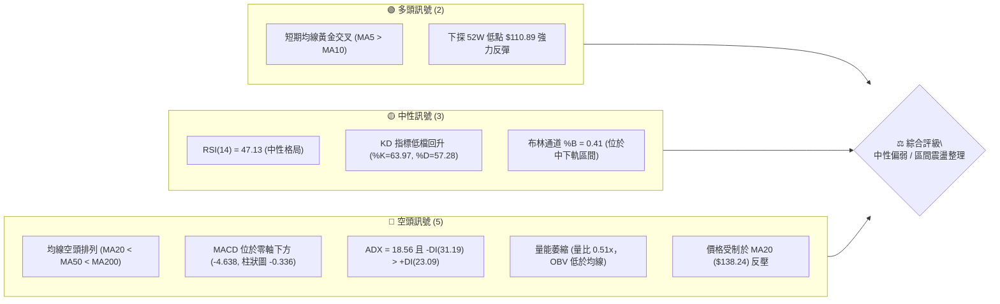
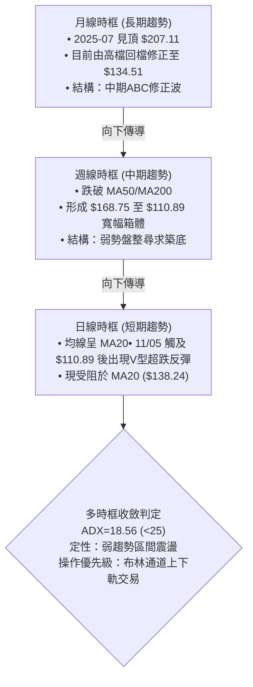
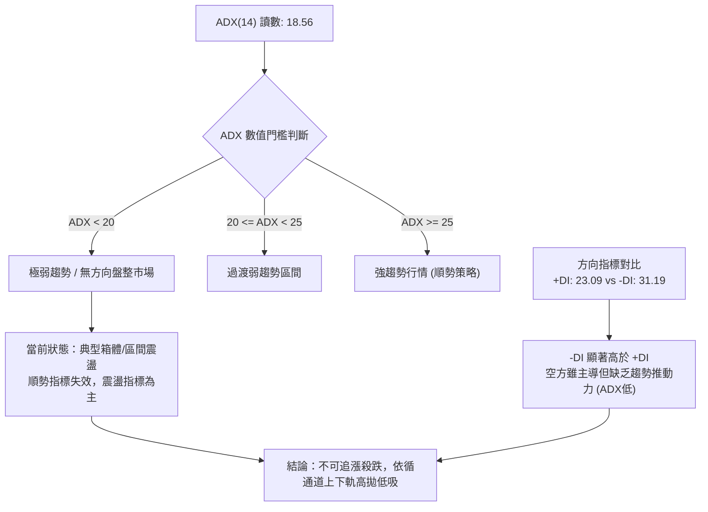
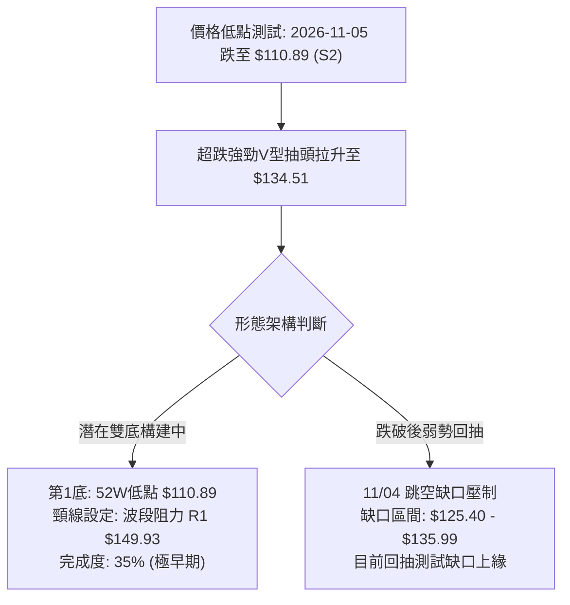
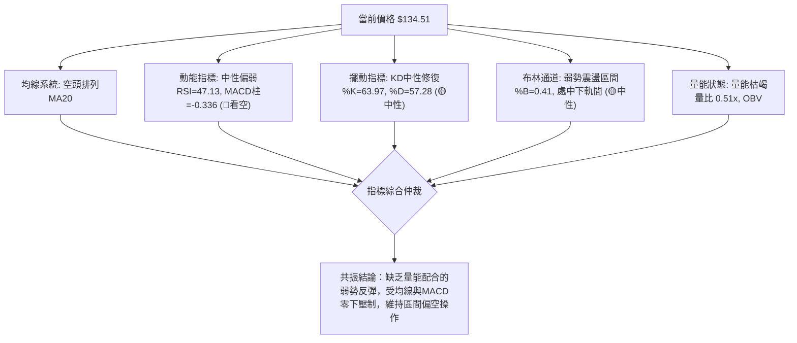
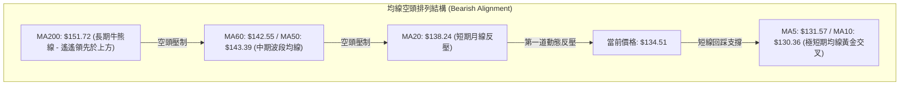
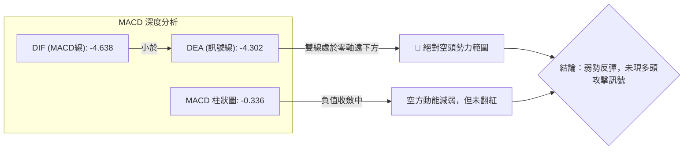
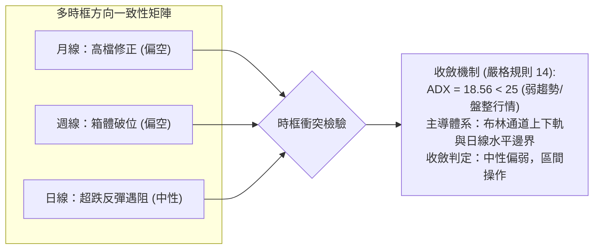
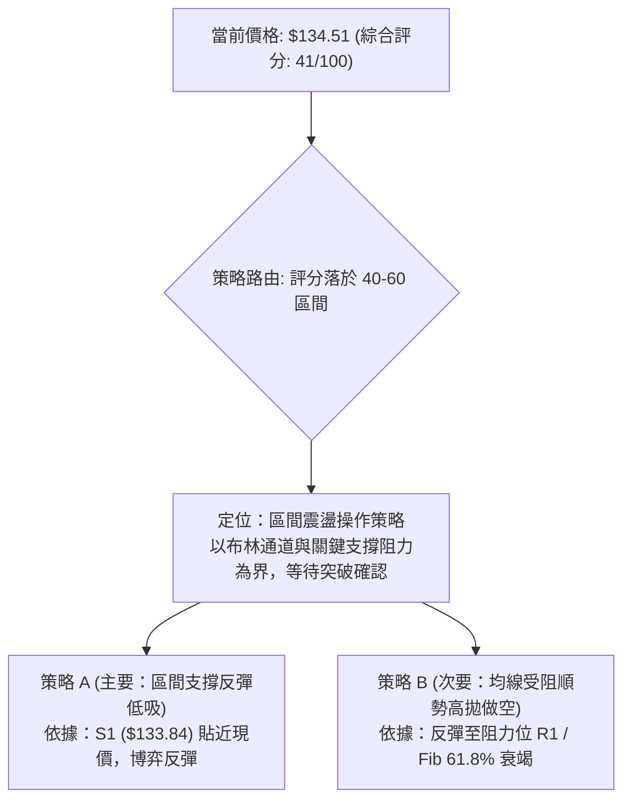
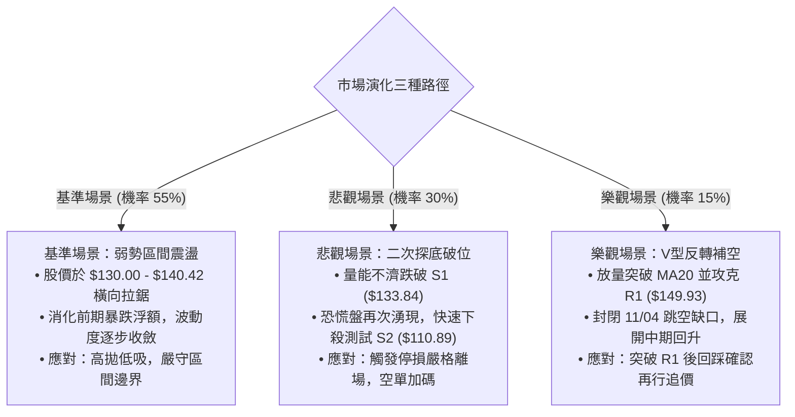

# VST 技術分析報告

> **報告日期**：2026-11-13 ｜ **語言**：繁體中文 ｜ **數據來源**：Yahoo Finance ｜ **當前價格**：$134.51

---

## 目錄

| 章節 | 內容 |
|------|------|
| [1. 技術面概覽](#1-技術面概覽) | 訊號儀表板、核心指標、評分卡 |
| [2. 趨勢分析](#2-趨勢分析) | 多時框趨勢、長中短期走勢 |
| [3. 圖表形態分析](#3-圖表形態分析) | 形態識別、K線組合、目標價 |
| [4. 支撐與阻力](#4-支撐與阻力) | 關鍵價位、斐波那契回調 |
| [5. 技術指標深度解讀](#5-技術指標深度解讀) | MA/RSI/MACD/布林/成交量 |
| [6. 動能與波動率](#6-動能與波動率) | 動能評估、ATR、Beta |
| [7. 多時框架總結](#7-多時框架總結) | 時框架評分矩陣 |
| [8. 交易策略建議](#8-交易策略建議) | 多空策略、風險報酬比 |
| [9. 風險提示與監控](#9-風險提示與監控) | 監控指標、風險場景 |

---

## 1. 技術面概覽

### 🎯 技術訊號儀表板



### 📊 核心指標速覽表

| 指標類別 | 指標名稱 | 當前數值 | 訊號 | 解讀 |
|----------|----------|----------|------|------|
| **價格** | 當前收盤價 | $134.51 | 🟡 | 位於52週區間 30.6% 分位，自 $110.89 反彈受阻於 $138 關卡 |
| **均線** | MA20 | $138.24 | 🔴 | 價格在 MA20 下方 (-2.70%)，短線反彈遭遇首道動態均線反壓 |
| **均線** | MA50 | $143.39 | 🔴 | 價格在 MA50 下方 (-6.19%)，中期波段趨勢仍受空方壓制 |
| **均線** | MA200 | $151.72 | 🔴 | 價格在 MA200 下方 (-11.34%)，長期牛熊分界線失守，結構偏空 |
| **動能** | RSI(14) | 47.13 | 🟡 | 處於 30–70 中性常態區間，未觸及超買亦無超賣，動能平淡 |
| **動能** | MACD(12,26,9) | -4.638 / -4.302 | 🔴 | 雙線位於零軸下方，柱狀圖為負 (-0.336)，空方動能主導 |
| **趨勢** | ADX(14) | 18.56 | 🟡 | ADX < 25 表明處於弱趨勢/區間震盪行情，-DI 高於 +DI 偏空 |
| **通道** | 布林帶 (%B) | 0.41 | 🟡 | 位於中軌 ($138.24) 與下軌 ($116.85) 之間，帶寬收斂 |
| **量能** | 20日均量比 | 0.51x | 🔴 | 最新量 3.54M 低於 20MA (7.00M)，量能不濟，OBV 疲弱 |
| **波動** | ATR(14) | $8.08 | 🔴 | 佔價格 6.01%，屬於高日線波動標的，需設置足夠風控緩衝 |

### 🏆 技術評分卡

```
╔══════════════════════════════════════════════════════════════╗
║              技術評分卡 — VST (2026-11-13)                  ║
╠══════════════════════════════════════════════════════════════╣
║ 趨勢強度      ████████░░░░░░░░░░░░  38/100  🔴 (ADX弱/偏空)    ║
║ 動能指標      █████████░░░░░░░░░░░  45/100  🟡 (RSI平/MACD負)  ║
║ 支撐穩定度    ██████████░░░░░░░░░░  52/100  🟡 (S1/S2有守)     ║
║ 成交量配合    ███████░░░░░░░░░░░░░  36/100  🔴 (量縮反彈疲弱)  ║
║ 形態完整度    █████████░░░░░░░░░░░  44/100  🟡 (區間打底中)    ║
║ 均線排列      ██████░░░░░░░░░░░░░░  31/100  🔴 (空頭完全排列)  ║
╠══════════════════════════════════════════════════════════════╣
║ 綜合評分      ████████░░░░░░░░░░░░  41/100  中性偏弱(區間震盪) ║
╚══════════════════════════════════════════════════════════════╝
```
*(註：綜合評分由六項子評分算術平均所得：(38 + 45 + 52 + 36 + 44 + 31) ÷ 6 = 41.0，四捨五入為 41/100，符合規則 18)*

---

## 2. 趨勢分析

### 🌐 多時框趨勢分析



### 📈 長期趨勢 — 12個月走勢圖（Unicode）

以下為 VST 過去 12 個月（2025-12 至 2026-11）月線收盤價走勢圖與關鍵高低點標註：

```
VST 月線走勢圖（過去12個月：2025-12 至 2026-11）
價格 ($)
$180 ┤                  ● (2026-02 高點: $173.13)
$170 ┤                 / \
$160 ┤●(2025-12:160.62)    \       ●─────●─────● (2026-04~06 箱體頂部 ~$159)
$150 ┤ \                  ● (03)  /     \     \
$140 ┤  \                149.87  /       \     \
$130 ┤   ● (2026-01:157.65)     /         ●─────●─────● (2026-08~10: ~$138)
$120 ┤                                                  \
$110 ┤                                                   ● (2026-11 現價: $134.51, 低點 $110.89)
     └────────────────────────────────────────────────────────────────
      12M   01M   02M   03M   04M   05M   06M   07M   08M   09M   10M   11M
```

#### 長期月線走勢特徵分析表

| 階段區間 | 起止收盤價 | 區間漲跌幅 | 走勢特徵與結構分析 |
|----------|------------|------------|--------------------|
| **2025-12 ~ 2026-02** | $160.62 → $173.13 | +7.79% | 嘗試挑戰前期歷史高檔，於 $173.13 形成次高點後動能衰竭 |
| **2026-02 ~ 2026-03** | $173.13 → $149.87 | -13.44% | 高檔獲利了結賣壓湧現，長黑K跌破多道短期均線 |
| **2026-03 ~ 2026-06** | $149.87 → $158.37 | +5.67% | 在 $150–$160 區間維持狹幅箱體橫盤整理，多空拉鋸 |
| **2026-06 ~ 2026-08** | $158.37 → $137.15 | -13.40% | 箱體下軌失守，觸發技術性停損賣盤，跌破中期防線 |
| **2026-08 ~ 2026-10** | $137.15 → $138.37 | +0.89% | 股價於 $138 附近橫盤鈍化，成交量持續萎縮 |
| **2026-10 ~ 2026-11** | $138.37 → $134.51 | -2.79% | 月中一度暴跌探底至 52W 低點 $110.89，隨後快速拉回目前收盤價 |

### 📊 中期趨勢（週線分析）

從近 20 週收盤走勢觀察，VST 於 2026 年 10 月初曾因短期消息激勵放量衝高至 $168.75（週收盤 $161.48，單週成交量高達 59.37M），但隨後三週遭遇猛烈拋售，連續出現長黑K棒回吐所有漲幅。

```
VST 中期週線壓力與支撐結構示意圖
價格 ($)
$170 ┤         ▲ 2026-10-09 波段高點 ($168.75) ─── [阻力 R3: $168.67]
$160 ┤        / \
$150 ┤───────/───\────────────── [阻力 R1: $149.93 / Fib 50%: $149.54]
$140 ┤      /     \───┬───┬─── [Fib 61.8%: $140.42 / MA20: $138.24]
$130 ┤─────/──────────┼───┼─── [支撐 S1: $133.84 / 現價: $134.51]
$120 ┤    /            \ /
$110 ┤───/──────────────▼───── [支撐 S2: $110.89 / 52W 低點 (2026-11-06)]
```

中期走勢顯示，多頭在突破 $160 後缺乏持續買盤，轉為巨幅洗盤震盪；2026-11-06 當週暴量 58.99M 跌破所有支撐下探 $110.89，確認中期趨勢轉入空方控盤的寬幅整理格局。

### ⚡ 趨勢強度評估（ADX 解讀）



#### ADX 趨勢強度對照解讀表

| 指標名稱 | 當前讀數 | 門檻區間 | 技術含義解讀 | 交易策略指引 |
|----------|----------|----------|--------------|--------------|
| **ADX(14)** | **18.56** | < 25 (弱趨勢/盤整) | 市場缺乏單邊推動動能，處於非趨勢狀態 | 嚴禁使用順勢追價系統，切換至區間震盪模型 |
| **+DI(14)** | **23.09** | 多方進攻指標 | 多方買盤意願微弱，未能形成推升波段 | 不具備向上發動波段攻擊的買力基礎 |
| **-DI(14)** | **31.19** | 空方壓制指標 | 空方力量顯著佔優，反彈皆面臨拋壓 | 逢反彈至阻力位容易引發空頭反撲 |
| **趨勢定性** | **弱勢震盪** | ADX < 25 & -DI > +DI | 空頭主導下的無趨勢弱勢震盪整理 | 依布林帶與關鍵支撐阻力進行邊界操作 |

---

## 3. 圖表形態分析

### 🔍 形態識別系統



#### 形態識別與信心度評估表（依規則 15）

| 形態名稱 | 信心度 | 判斷依據（引用數據） | 完成度 | 目標價（附計算式） |
|----------|--------|----------------------|--------|--------------------|
| **潛在雙底 (Double Bottom)** | 35% | 僅於 2026-11-05 形成單一孤立低點 $110.89 (S2)，目前僅為初次回彈，尚未進行第二隻腳回踩確認 | 35% | 若頸線 R1 $149.93 突破：<br/>目標價 = 頸線 $149.93 + (頸線 $149.93 - 底點 $110.89) = $188.97 |
| **跳空暴跌後回抽缺口** | 70% | 11/04 開盤 $125.40 較前一日收盤 $139.59 跳空向下，近4根日K回補至 $134.51 遭遇阻力 | 85% | 形態回抽完畢，目標回測支撐 S1 $133.84，若失守測斐波那契 78.6% 回調位 $127.43 |
| **指標型態：布林下軌超跌反彈** | 80% | 價格跌破布林下軌 $116.85 後引發均值回歸，向布林中軌 MA20 ($138.24) 靠攏 | 75% | 短線反彈理論目標為布林中軌 $138.24 |

*(說明：由於當前圖表僅出現單點極端低位抽升，雙底形態尚未成熟，信心度僅 35%，後市分析主要基於布林通道均值回歸與缺口回抽等指標型解讀。)*

### 🕯️ 重要K線形態分析（依規則 19 嚴格檢驗）

#### 近 10 根日K線組合分析

| 日期 (日K) | 開盤價 | 最高價 | 最低價 | 收盤價 | 成交量 | K線形態識別 | 技術意義與多空訊號 |
|------------|--------|--------|--------|--------|--------|-------------|--------------------|
| 2026-10-30 | 136.95 | 139.82 | 135.86 | 138.37 | 5,270,200 | 小陽十字線 | 狹幅整理，多空觀望 🟡 |
| 2026-11-02 | 140.00 | 140.50 | 134.21 | 134.61 | 4,797,900 | 中黑棒 | 開高走低，失守短均線 🔴 |
| 2026-11-03 | 135.99 | 142.40 | 135.99 | 139.59 | 5,884,400 | 光腳中陽線 | 多方反撲，上攻 MA20 受阻 🟡 |
| 2026-11-04 | 125.40 | 128.07 | 117.27 | 120.29 | 20,441,400 | 跳空放量大黑棒 | 空方暴烈宣洩，跳空破位大跌 🔴 |
| 2026-11-05 | 116.86 | 118.91 | 110.89 | 112.89 | 15,339,900 | 探底長下影小黑棒 | 觸及 52W 低點 $110.89 獲支撐 🟡 |
| 2026-11-06 | 119.57 | 125.80 | 118.86 | 124.80 | 12,534,200 | 實體中陽棒 | 低檔確認買盤介入，啟動V反 🟢 |
| 2026-11-09 | 128.00 | 134.80 | 125.09 | 133.92 | 7,382,300 | 跳空走高大陽棒 | 延續超跌反彈動能，收復失地 🟢 |
| 2026-11-10 | 130.90 | 134.13 | 129.30 | 131.18 | 4,375,100 | 縮量倒轉錘頭小黑線 | 反彈遇壓，買盤追價意願下滑 🟡 |
| 2026-11-11 | 135.98 | 136.73 | 133.20 | 133.45 | 4,270,100 | 高開低走假黑線 | 衝高 $136.73 後回落，呈現滯漲 🔴 |
| 2026-11-12 | 130.62 | 136.65 | 130.01 | 134.51 | 3,544,100 | 下影小陽棒 (量縮) | 低測 $130.01 有守，回升至 $134.51 🟡 |

#### 近 8 根週K線組合分析

| 日期 (週K) | 開盤價 | 最高價 | 最低價 | 收盤價 | 成交量 | K線形態識別 | 技術意義與多空訊號 |
|------------|--------|--------|--------|--------|--------|-------------|--------------------|
| 2026-09-25 | 142.00 | 142.64 | 135.98 | 138.46 | 22,341,300 | 盤整中陰線 | 測試 $136 支撐 🟡 |
| 2026-10-02 | 138.08 | 143.51 | 133.44 | 140.02 | 34,710,000 | 下影長陽星 | 低檔放量打底，買盤湧入 🟢 |
| 2026-10-09 | 144.04 | 168.75 | 140.90 | 161.48 | 59,368,900 | 暴量噴出長陽棒 | 多頭全力進攻創波段高點 🟢 |
| 2026-10-16 | 162.67 | 164.25 | 145.85 | 152.02 | 31,699,400 | 高位長黑吞噬 | 衝高無力，主力出貨反轉 🔴 |
| 2026-10-23 | 154.10 | 158.74 | 136.17 | 140.16 | 31,911,100 | 實體大陰線 | 空頭摜壓，跌破多道短期支撐 🔴 |
| 2026-10-30 | 140.90 | 147.82 | 135.86 | 138.37 | 24,269,600 | 上影小陰線 | 反彈無量，再度承壓 🔴 |
| 2026-11-06 | 140.00 | 142.40 | 110.89 | 124.80 | 58,997,800 | 暴量恐慌長下影黑K | 恐慌拋盤湧現，測試 52W 底 🟡 |
| 2026-11-12 | 128.00 | 136.73 | 125.09 | 134.51 | 19,571,600 | 縮量修復小陽棒 | 超跌反彈，成交量未獲確認 🟡 |

### 📉 ASCII 走勢形態示意圖

```
VST 日線超跌 V 反與缺口壓制結構
價格 ($)
$140 ┤     ●[11/03: 139.59]
     │      \ ── 11/04 跳空缺口 ($125.40 - $135.99) ──
$135 ┤       \                         ●[11/11: 136.73 高點]
     │        \                       / \
$134 ┤         \                     /   ●[11/12 現價: 134.51]
$130 ┤          \                   ●[11/09: 133.92]
     │           \                 /
$125 ┤            \               ●[11/06: 124.80]
$120 ┤             ●[11/04: 120.29]
$115 ┤              \
$110 ┤               ●───────● [11/05: 低點 110.89 (S2) 觸底 V 型回升]
     └──────────────────────────────────────────────────────────
           11/03   11/04   11/05   11/06   11/09   11/11   11/12
```

### 🎯 形態目標價計算

根據日K線於 11/05 創下的波段低點 $110.89 至 11/11 反彈高點 $136.73，若將此波視為超跌反彈波（反彈高度為 $136.73 - $110.89 = $25.84）：
1. **反彈終止回測情境**：若現價 $134.51 受阻於 MA20 ($138.24) 且失守支撐位 S1 ($133.84)，向下測量目標為斐波那契 78.6% 回調位 **$127.43**；若跌破則直指 52W 低點 S2 **$110.89**。
2. **多頭擴展情境**：若帶量突破阻力位 R1 ($149.93)，則向上測量目標為阻力位 R2 **$155.69**。

---

## 4. 支撐與阻力

### 🗺️ 關鍵價位分布圖（Unicode）

```
VST 價位結構分布圖（OHLCV 精確計算）
═════════════════════════════════════════════════════════════════
$188.20 ║████████████████████████████████████║ 52W 歷史最高點 (Fib 0.0%)
$169.95 ║████████████████████████            ║ 斐波那契 23.6% 壓力
$168.67 ║████████████████████████████        ║ 強阻力位 R3 (波段頂部聚類)
$158.67 ║████████████████                    ║ 斐波那契 38.2% / 布林上軌 $159.64
$155.69 ║████████████████████                ║ 次級阻力位 R2
$151.72 ║██████████████                      ║ MA200 牛熊分界線
$149.93 ║████████████████████████            ║ 關鍵阻力位 R1 / Fib 50.0% ($149.54)
$140.42 ║████████████                        ║ 斐波那契 61.8% / MA20 ($138.24)
$134.51 ╠════════════════════════════════════╣ ◄ 當前收盤價 ($134.51)
$133.84 ║▓▓▓▓▓▓▓▓▓▓▓▓▓▓▓▓▓▓▓▓▓▓▓▓▓▓▓▓        ║ 近期核心支撐 S1 (-0.50%)
$127.43 ║▓▓▓▓▓▓▓▓▓▓▓▓▓▓▓▓                    ║ 斐波那契 78.6% 回調支撐
$116.85 ║▓▓▓▓▓▓▓▓▓▓                          ║ 布林通道下軌
$110.89 ║████████████████████████████████████║ 強支撐位 S2 / 52W 低點 (Fib 100.0%)
═════════════════════════════════════════════════════════════════
```

### 🚧 阻力位分析表

*(價位嚴格引用自數據之「關鍵價位」OHLCV 波段高點聚類)*

| 阻力級別 | 價位 | 形成原因 | 突破難度 | 重要性 |
|----------|------|----------|----------|--------|
| **R1** | **$149.93** (+11.47%) | 近一年多個波段折返高點密集成交區，與 50% 斐波那契回調位 ($149.54) 重疊共振 | 🔴 極高 | ★★★★★<br/>短線多空分水嶺 |
| **R2** | **$155.69** (+15.75%) | 2026年4至6月箱體整理平台下沿，密集成交套牢區，臨近 MA240 ($153.88) | 🔴 高 | ★★★★☆<br/>中期反彈強阻力 |
| **R3** | **$168.67** (+25.39%) | 2026-10-09 當週爆量 (59.37M) 所創下的波段高點 ($168.75) 聚類區 | 🔴 極難 | ★★★★★<br/>長期牛市重啟關卡 |

### 🛡️ 支撐位分析表

*(價位嚴格引用自數據之「關鍵價位」OHLCV 波段低點聚類)*

| 支撐級別 | 價位 | 形成原因 | 守住機率 | 重要性 |
|----------|------|----------|----------|--------|
| **S1** | **$133.84** (-0.50%) | 近一年多次回踩獲得承接的波段低點聚類，目前價格 ($134.51) 正貼線測試 | 🟡 55% | ★★★★☆<br/>短線多頭生命線 |
| **S2** | **$110.89** (-17.56%) | 52 週最低點 (2026-11-05 觸及)，暴量恐慌拋盤後的大級別多頭最後防線 | 🟢 85% | ★★★★★<br/>年度絕對底線 |
| **S3** | **N/A（數據未提供）** | 數據中未偵測到低於 S2 之波段低點聚類數值 | N/A | N/A |

### 📐 斐波那契回調位分析

依據 52 週波動區間（高點 $188.20 至 低點 $110.89，全幅落差 $77.31）計算之各回調水平如下：

| 斐波那契比例 | 關鍵價位 | 與當前價差距 | 技術解讀與角色轉換 |
|--------------|----------|--------------|--------------------|
| **0.0% (52W High)** | **$188.20** | +39.92% | 全年波段頂部，長期多頭終極目標 |
| **23.6%** | **$169.95** | +26.35% | 與 R3 ($168.67) 形成高空雙重壓力防線 |
| **38.2%** | **$158.67** | +17.96% | 逼近布林通道上軌 ($159.64)，強勢多頭修正極限 |
| **50.0%** | **$149.54** | +11.17% | 與阻力位 R1 ($149.93) 完美重疊，為多空均衡核心分界 |
| **61.8% (黃金分割)** | **$140.42** | +4.39% | 弱勢反彈之第一道強阻力關卡，壓制現階段走勢 |
| **78.6%** | **$127.43** | -5.26% | 深度回調防守位，若 S1 告破之次級防線 |
| **100.0% (52W Low)**| **$110.89** | -17.56% | 與 S2 強支撐完全重合，中長期結構之極限底部 |

**現價區間解讀**：當前價格 **$134.51** 恰好落在 **61.8% ($140.42)** 與 **78.6% ($127.43)** 之間。在技術分析中，當反彈無力站穩 61.8% 黃金分割線時，走勢被定義為「弱勢技術性修正」；目前股價受制於 61.8% 之下，隨時存在向 78.6% ($127.43) 回測尋求二次支撐的風險。

---

## 5. 技術指標深度解讀

### 🎛️ 指標訊號總覽



### 📈 移動平均線排列分析



當前移動平均線呈現典型的空頭完全排列（MA20 < MA50 < MA200，且價格在所有中期與長期均線下方）。短期內唯一的多頭微弱跡象是 MA5 ($131.57) 上穿 MA10 ($130.36) 出現低檔微型黃金交叉，這解釋了為何近幾日自 $110.89 出現短線反彈；然而，上方 MA20 ($138.24) 正在快速下行扣高，距離現價僅 2.70%，將形成強烈的蓋頭反壓。

### 📉 RSI(14) 分析

```
RSI(14) 讀數：47.13
0 ────────── 30 ──────────────── 50 ────── 70 ────────── 100
[  超賣區間  ]   [     中性偏弱區    ▲    ]   [  超買區間  ]
                                47.13
進度條展示：█████████░░░░░░░░░░░ 47.13%
```

- **超買超賣判定**：RSI 目前讀數為 47.13，處於 30 至 70 的中性區間，脫離了 11/05 極端暴跌時的超賣警戒，但仍處於 50 多空分界線下方，多方尚未取得動能優勢。
- **背離判斷**：根據近 20 根 K 棒的首尾對比，價格由 10/23 的高位滑落至 $134.51，RSI 亦同步從 50–60 區間滑落至 47.13，**無明顯頂背離或底背離現象**。動能與價格走勢基本同步，未出現轉折背離訊號。

### 📊 MACD(12,26,9) 訊號解讀



- DIF 與 DEA 雙雙深陷零軸負值區（-4.638 與 -4.302），表明中期趨勢完全被空方鎖定。
- MACD 柱狀圖數值為 -0.336，雖然負值較上週 (-3.166) 大幅收斂，顯示暴跌後的恐慌賣壓減輕，但尚未形成金叉翻紅，不可盲目判定中期反轉確立。

### 📦 布林通道分析

```
VST 布林通道 (20, 2) 結構示意圖
價格 ($)
$159.64 ┬────────────────────────────────────────── BB 上軌
        │
$145.00 │
        │
$138.24 ┼ - - - - - - - - - - - - - - - - - - - -  BB 中軌 (MA20)
        │                   ● 現價: $134.51 (%B = 0.41)
$130.00 │
        │
$116.85 ┴────────────────────────────────────────── BB 下軌
```

- **帶寬與位置**：通道上軌為 $159.64，中軌為 $138.24，下軌為 $116.85。目前 %B 為 0.41，價格位於中軌與下軌之間。
- **走勢涵義**：日前股價於 11/05 盤中跌破下軌 ($110.89 < $116.85) 造成極度發散，隨後啟動典型的布林通道「回歸中軌」走勢。目前反彈已完成過半，向上直逼中軌 $138.24，預期中軌附近將遇到極大反抗。

### 💹 成交量分析（量價配合度）

- **量比萎縮**：最新成交量僅 3,544,100 股，相較於 20 日均量 6,998,845 股，量比僅 **0.51x**（萎縮近半）。
- **價漲量縮**：近 4 個交易日價格自 $112.89 回升至 $134.51，但成交量卻從 20.44M → 15.33M → 12.53M → 7.38M → 4.37M → 3.54M 呈現顯著的階梯式遞減，呈現嚴重的**價漲量縮（量價背離）**。
- **OBV 能量潮**：OBV 趨勢目前明確低於其均線（OBV < MA），證實資金並未大規模積極進場抄底，本次上漲純屬無量空頭回補，行情續航力堪憂。

---

## 6. 動能與波動率

### ⚡ 動能評估四象限

```
動能與波動率定位矩陣
  高波動率 (High Volatility)
      │
  Q3  │  Q4 [當前位置 ★]
      │  動能偏弱 / 波動率極高
      │  (ATR 6.01%, Beta 1.375, -DI > +DI)
──────┼──────────────────────── 動能強度 (Momentum)
  Q1  │  Q2
      │
  低波動率 (Low Volatility)
```

| 象限 | 動能維度 | 波動維度 | VST 當前狀態 | 交易環境與風控評估 |
|------|----------|----------|--------------|--------------------|
| **Q1** | 強動能 | 低波動 | — | 穩定單邊趨勢，最佳順勢加碼環境 |
| **Q2** | 弱動能 | 低波動 | — | 狹幅無聊盤整，等待突破方向確認 |
| **Q3** | 強動能 | 高波動 | — | 主升浪/主跌浪快速推進，高收益高風險 |
| **Q4** | **弱動能** | **高波動** | **VST 目前定位 (★)** | **洗盤劇烈但缺乏持續推動力，假突破多，嚴控停損** |

### 📊 ATR 波動率分析

- **ATR(14) 數值**：**$8.08**，佔當前股價比例高達 **6.01%**（Wilder 計算法）。
- **波動特徵解讀**：每日平均波動超過 8 美元，這意味著 VST 具備極高的日內與跨日雜訊。
- **止損距離建議**：
  - *短期日內/隔夜交易緩衝*：至少需預留 1.0x ATR ($8.08) 的波動空間。
  - *波段交易止損設定*：建議設置於關鍵支撐位下方 1.5x 至 2.0x ATR 處（即 $12.12 – $16.16 緩衝區間），以防範類似 11/05 單日劇烈下影線引發的非必要洗盤停損。

### 📐 Beta 與市場相關性

- **Beta 係數**：**1.375**。
- **市場特徵**：作為公用事業/獨立發電商（IPP），VST 的 Beta 顯著高於傳統公用事業（傳統多在 0.5–0.7），顯示該股受 AI 數據中心用電等題材激勵，具備極強的高彈性成長股屬性。當大盤（S&P 500）回檔 1% 時，VST 理論平均回檔達 1.375%，投機資金進出頻繁，需留意大盤系統性風險對其放大的衝擊。

---

## 7. 多時框架總結

### 📋 時框架評分表

| 時框架 | 趨勢方向 | 動能表現 | 均線排列 | 圖表形態 | 綜合評分 | 戰略建議 |
|--------|----------|----------|----------|----------|----------|----------|
| **長期 (月線)** | 中性偏弱 🔴 | 衰退 (高檔回落) | 仍守於長期均線之上 | ABC 修正波進行中 | **45/100** | 不盲目長線抄底，等待築底 |
| **中期 (週線)** | 空頭承壓 🔴 | MACD雙線零下 | MA50 形成反壓 | 跌破高檔箱體下軌 | **38/100** | 逢高減碼，防範二次探底 |
| **短期 (日線)** | 震盪反彈 🟡 | RSI修復/KD向上 | MA20<MA50<MA200 (空排列)| V型抽升回補缺口 | **48/100** | 區間交易，快進快出不戀戰 |

### 🔲 綜合訊號矩陣



### ⚖️ 多時框收斂結論

根據嚴格的多時框收斂規則（規則 14）：
1. **行情定性**：當前 ADX(14) 讀數為 **18.56**，明確小於 25 臨界值，確認市場處於**無趨勢的弱勢盤整行情**而非單邊趨勢行情。
2. **主導維度取捨**：在盤整行情中，中長期的均線方向主要提供「頂部強壓邊界」，而交易操作則完全回歸**日線布林通道上下軌 ($116.85 – $159.64) 與水平支撐阻力位**。日線的短線反彈因「價漲量縮」且受阻於 MA20 ($138.24)，無法扭轉週線的空方主導優勢。
3. **唯一方向性結論**：**中性偏弱觀望，定位為區間震盪整理**。評分卡分數為 **41/100**，操作上禁止單邊追高，應以「回踩支撐低吸、逢阻力高拋」的震盪思維應對。

---

## 8. 交易策略建議

### 🗺️ 策略決策流程圖



### 🧭 策略路由（依評分卡分流）

> **當前主策略方向 = 區間震盪操作（等待突破確認，依評分 41/100）**
> 
> *依據評分卡規則：綜合評分為 41/100，落於 40–60 之中性區間，不進行單邊強烈單向押注，主推以布林帶中下軌及關鍵支撐 S1 為邊界的「區間低吸短多」與「阻力位高拋做空」雙向對稱策略。*

### 🎯 價格情境階梯（Price Scenarios）

*(價位嚴格引用自第 4 章由 OHLCV 計算之關鍵價位)*

| 觸發條件 | 下一目標 | 後續延伸 | 情境含義與技術定性 |
|----------|----------|----------|--------------------|
| **強勢突破 R1 ($149.93)** | **R2 ($155.69)** | **R3 ($168.67)** | 短線轉強，完成雙底頸線突破，展開中期回升波 |
| **站穩現價區間 ($133.84–$140.42)** | **MA20 ($138.24)** | **Fib 50% ($149.54)** | 區間震盪，消化 11/04 跳空缺口套牢賣壓 |
| **跌破核心支撐 S1 ($133.84)** | **Fib 78.6% ($127.43)** | **S2 ($110.89)** | 中期轉弱，反彈告終，向下重啟二次探底測試 |

### 📊 情境機率分佈

| 情境類別 | 機率預估 | 主要技術依據 |
|----------|----------|--------------|
| **區間弱勢震盪 (主情境)** | **55%** | ADX = 18.56 極度低迷，布林帶寬度收斂，量能萎縮至 0.51x，多空均無力打破平衡 |
| **回落再探底 (次情境)** | **30%** | 均線空頭排列，MACD 處於零下 (-4.638)，OBV 疲軟，受制於 MA20 壓制隨時破位 |
| **強勢反轉上行 (極端情境)** | **15%** | 需補足大量封閉跳空缺口並放量站上 R1 ($149.93)，目前量能條件顯著不足 |

### 🟢 主策略詳情（區間操作多空策略雙軌）

*(註：風險報酬比嚴格依規則 17 計算：(目標價 T1 − 進場價) ÷ (進場價 − 止損價))*

| 策略要素 | 策略 A (區間低吸 / 支撐反彈策略) | 策略 B (阻力回落 / 順勢高拋做空策略) |
|----------|----------------------------------|--------------------------------------|
| **操作方向** | 多頭 (Long) | 空頭 (Short) |
| **進場條件** | 現價回踩支撐位 S1 守穩，出現止跌信號 | 價格反彈至斐波那契 61.8% 與 MA20 處受阻滯漲 |
| **進場價格** | **$134.51** (現價直接進場) | **$140.42** (斐波那契 61.8% 阻力位) |
| **目標價 T1** | **$149.93** (阻力位 R1 / Fib 50.0%) | **$127.43** (斐波那契 78.6% 回調位) |
| **目標價 T2** | **$155.69** (阻力位 R2) | **$110.89** (支撐位 S2 / 52W 低點) |
| **止損價格** | **$127.43** (斐波那契 78.6% 回調位) | **$149.93** (阻力位 R1，突破止損) |
| **止損空間** | $134.51 − $127.43 = $7.08 | $149.93 − $140.42 = $9.51 |
| **獲利空間 (T1)** | $149.93 − $134.51 = $15.42 | $140.42 − $127.43 = $12.99 |
| **風險報酬比** | **1 : 2.18（以 T1 計）**<br/>*(以 T2 計: 1 : 2.99)* | **1 : 1.37（以 T1 計）**<br/>*(以 T2 計: 1 : 3.11)* |
| **成功機率** | **50%** | **55%** |
| **建議倉位** | **10% – 15%** (輕倉博弈) | **15% – 20%** (順大趨勢偏空輕倉) |

### 🔴 反向風險觸發點（對沖提示）

- **做多風控觸發**：若日K收盤價實體**跌破 S1 ($133.84)**，代表反彈結構遭到破壞，多單應立即停損出場，切勿向下攤平。
- **做空風控觸發**：若日K線伴隨量能突破放大並**站穩 R1 ($149.93)** 之上，代表空頭波段結構徹底失效，空單必須無條件止損，防範軋空行情。

### ⭐ 整體訊號強度評星

```
╔══════════════════════════════════════════════════════════════╗
║ 做多訊號強度：★★☆☆☆  (2/5星 - 僅屬跌深超跌反彈，量能未配)     ║
║ 做空訊號強度：★★★☆☆  (3/5星 - 大趨勢偏空，但短線急跌後鈍化)   ║
║ 整體可信度：  ★★★☆☆  (3/5星 - ADX<25 震盪市，訊號常有假突破) ║
╚══════════════════════════════════════════════════════════════╝
```

---

## 9. 風險提示與監控

### ✅ 關鍵監控指標 Checklist

```
╔══════════════════════════════════════════════════════════════╗
║              VST 關鍵技術監控清單 (Trading Checklist)        ║
╠══════════════════════════════════════════════════════════════╣
║ [ ] 價格是否跌破關鍵支撐 S1 ($133.84)？                      ║
║     └─ 若跌破，下一防線直指 Fib 78.6% ($127.43) 及 S2        ║
║ [ ] 日成交量是否回升至 20 日均量 (6.99M) 以上？               ║
║     └─ 若持續低於 4M，任何向上突破皆視為假突破               ║
║ [ ] RSI(14) 能否有效穿越 50.00 多空分水嶺？                  ║
║     └─ 若在 50 附近再度掉頭向下，確認動能衰竭                 ║
║ [ ] 價格觸及 MA20 ($138.24) 時的 K 線形態為何？             ║
║     └─ 若出現長上影線或黑K吞噬，為絕佳空點                   ║
║ [ ] MACD 柱狀圖是否即將翻紅（由負轉正）？                     ║
║     └─ 翻紅方能確認短波段底部確立                            ║
╚══════════════════════════════════════════════════════════════╝
```

### ⚠️ 風險場景分析



### 🛡️ 風險管理重要提醒

1. **高 ATR 波動下的部位控制**：VST 當前每日 ATR 高達 **$8.08 (6.01%)**，屬於劇烈波動個股。單筆交易所承擔之風險金額嚴格限制在總資產的 **1% 至 1.5%** 內，換算倉位不可超過總部位的 20%，嚴禁在震盪市中使用高倍槓桿。
2. **防範流動性與假突破陷阱**：在當前量比僅 0.51x 的無量環境中，做市商極易透過少量籌碼拉抬或摜壓造成盤中假突破。進出場依據應以**日K線收盤價（Daily Close）**為準，避免盤中被隨機雜訊洗出場。
3. **宏觀與基本面事件共振**：VST 兼具公用事業與 AI 高彈性題材，Beta 為 1.375，且近期機構賣壓與降評雜音漸增（如 Keybanc 降評至 Sector Weight），需嚴密防範大盤拉回引發的聯袂殺跌。

---

## 📋 報告總結

```
╔════════════════════════════════════════════════════════════════╗
║                   VST 技術分析報告總結                        ║
╠════════════════════════════════════════════════════════════════╣
║ 報告日期：2026-11-13                                          ║
║ 當前價格：$134.51                                             ║
║ 分析評級：⚖️ 中性偏弱 / 區間震盪整理 (評分: 41/100)           ║
║                                                                ║
║ 關鍵結論：                                                     ║
║ ├─ 長期趨勢：🔴 高檔回檔修正中，下測 52W 支撐                 ║
║ ├─ 中期趨勢：🔴 週線跌破主要均線，處於寬幅箱體弱勢區間         ║
║ ├─ 短期趨勢：🟡 跌深反彈，遇 MA20 ($138.24) 蓋頭反壓          ║
║ ├─ 關鍵支撐：S1: $133.84 (-0.50%) ｜ S2: $110.89 (-17.56%)     ║
║ ├─ 關鍵阻力：R1: $149.93 (+11.47%) ｜ R2: $155.69 (+15.75%)    ║
║ └─ 分析師共識目標：$202.48 (基本面目標，技術面目前嚴重脫節)   ║
║                                                                ║
║ 最優策略組合：                                                 ║
║ 1. 🥇 最佳機會：區間支撐反彈 (策略 A)                         ║
║    進場 $134.51，止損 $127.43，目標 $149.93 (風報比 1:2.18)    ║
║ 2. 🥈 次選機會：均線受阻高拋放空 (策略 B)                     ║
║    進場 $140.42，止損 $149.93，目標 $127.43 (風報比 1:1.37)    ║
║ 3. 🥉 保守選擇：空倉觀望                                       ║
║    靜待 ADX > 25 且價格帶量突破 R1 ($149.93) 後再行順勢進場   ║
╚════════════════════════════════════════════════════════════════╝
```

---

> ⚠️ **免責聲明**：本報告為技術分析研究，所有數據、圖表及估算均嚴格基於歷史量價數據計算。本報告**僅供研究與學術參考**，**不構成任何要約、招攬或投資建議**。市場具有高度不確定性，交易決策應依個人風險承受能力獨立判斷並自負盈虧。

---

*報告生成時間：2026-11-13 ｜ 數據來源：Yahoo Finance ｜ 分析框架：多時框技術分析體系 (MTFA)*