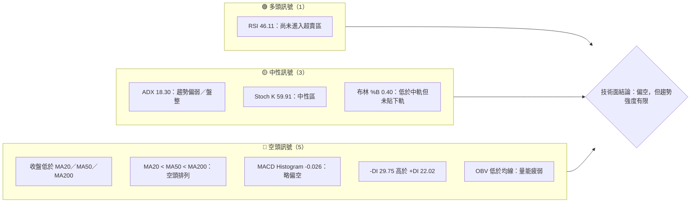
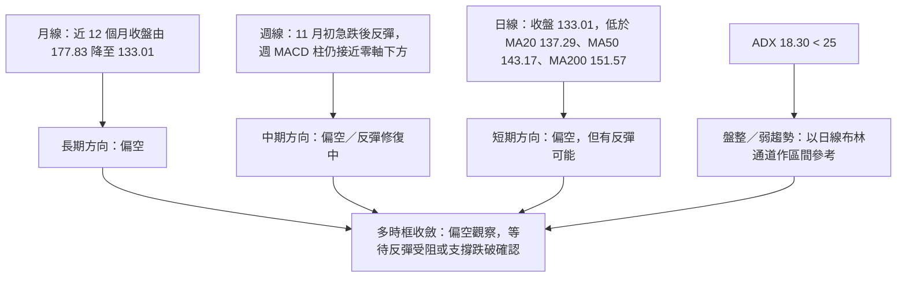
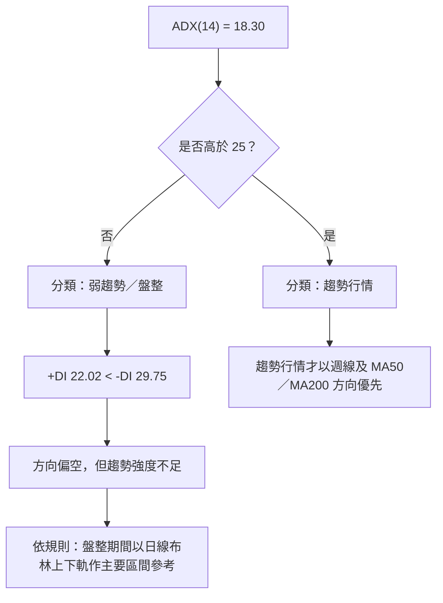
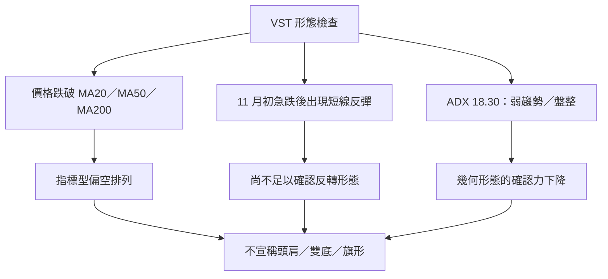
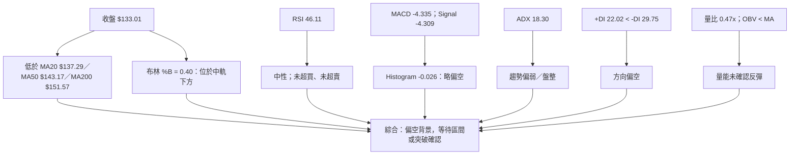
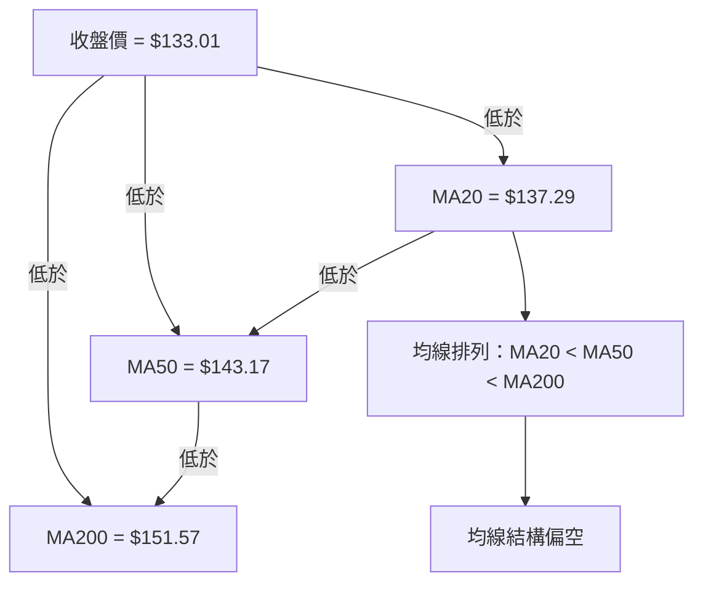
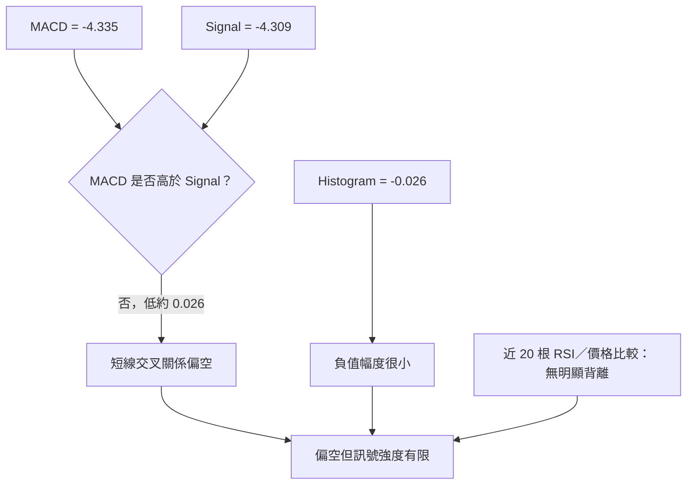
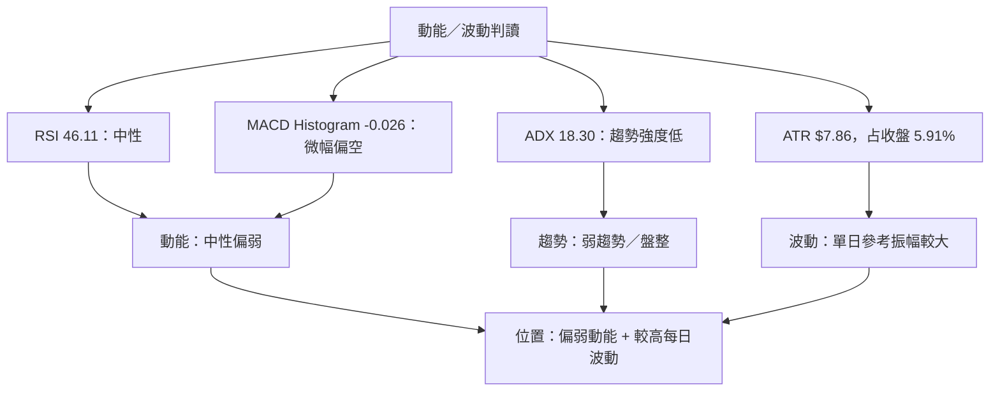
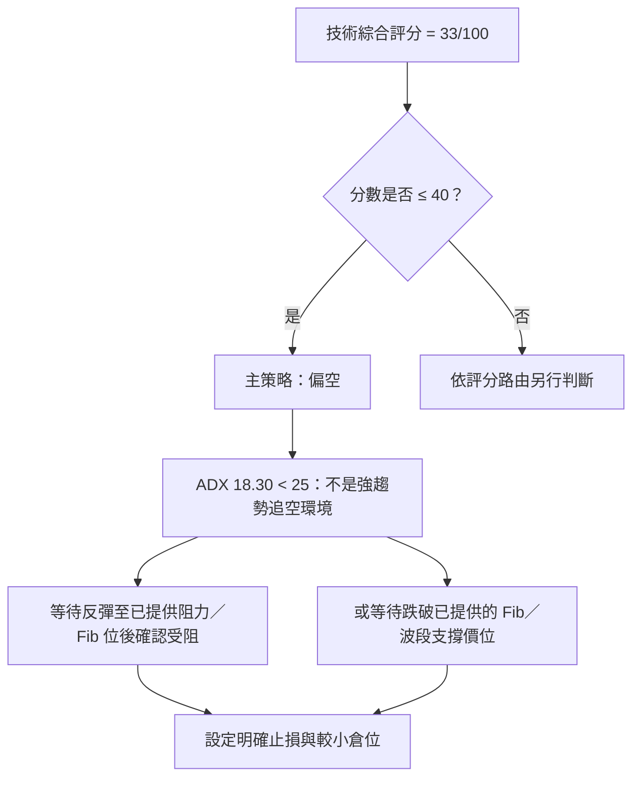
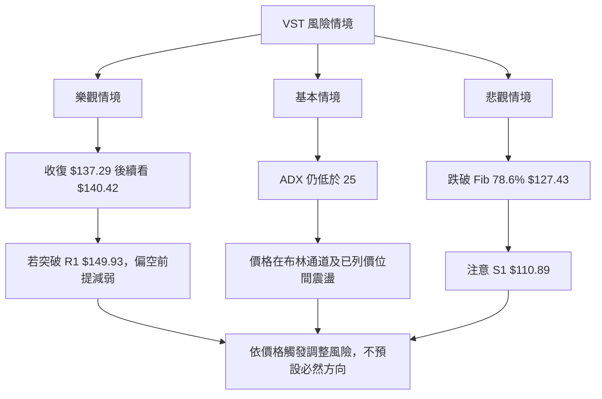

# VST 技術分析報告

> **報告日期**：2026-11-14 ｜ **語言**：繁體中文 ｜ **數據來源**：題示 Yahoo Finance 數據包  
> **當前價格**：**$133.01**（2026-11-13 收盤）

---

## 目錄

| 章節 | 內容 |
|------|------|
| [1. 技術面概覽](#1-技術面概覽) | 訊號儀表板、核心指標、評分卡 |
| [2. 趨勢分析](#2-趨勢分析) | 多時框趨勢、長中短期走勢 |
| [3. 圖表形態分析](#3-圖表形態分析) | 形態識別、K 線組合、目標價 |
| [4. 支撐與阻力](#4-支撐與阻力) | 關鍵價位、斐波那契回調 |
| [5. 技術指標深度解讀](#5-技術指標深度解讀) | MA／RSI／MACD／布林／成交量 |
| [6. 動能與波動率](#6-動能與波動率) | 動能評估、ATR、Beta |
| [7. 多時框架總結](#7-多時框架總結) | 時框架評分矩陣 |
| [8. 交易策略建議](#8-交易策略建議) | 主策略、風險報酬比 |
| [9. 風險提示與監控](#9-風險提示與監控) | 監控指標、風險場景 |

---

## 1. 技術面概覽

### 🎯 技術訊號儀表板

VST 目前呈現「**均線偏空、趨勢強度不足、短線動能近中性、價格仍處於區間下半部**」的混合訊號。ADX 為 18.30，依本報告所採用門檻，現階段應視為盤整／弱趨勢，而非已確認的強趨勢行情。



### 📊 核心指標速覽表

| 指標類別 | 指標名稱 | 當前數值 | 訊號 | 解讀 |
|----------|----------|----------:|:---:|------|
| 價格 | 收盤價 | **$133.01** | 🟡 | 僅代表 2026-11-13 收盤；低於 MA20、MA50、MA200 |
| 區間 | 52 週高／低 | $188.20／$110.89 | 🔴 | 收盤位於 52 週區間約 28.6% 位置，靠近區間下半部 |
| 均線 | MA20 | $137.29 | 🔴 | 收盤低於 MA20 $4.28 |
| 均線 | MA50 | $143.17 | 🔴 | 收盤低於 MA50 $10.16 |
| 均線 | MA200 | $151.57 | 🔴 | 收盤低於 MA200 $18.56 |
| 動能 | RSI(14) | 46.11 | 🟡 | 中性，未超買亦未超賣 |
| 動能 | MACD／Signal | -4.335／-4.309 | 🔴 | MACD 略低於訊號線 |
| 波動 | ATR(14) | $7.86 | 🟡 | 相當於收盤價 5.91%，每日波動偏高 |
| 趨勢 | ADX(14) | 18.30 | 🟡 | 趨勢強度偏弱，低於 25 |
| 量能 | 量比／OBV | 0.47x／低於均線 | 🔴 | 最新成交量低於 20 日均量，量能確認不足 |

### 🏆 技術評分卡

下列分數採 0–100 分制；綜合評分依規則以六項子評分算術平均、四捨五入至整數。分數是依目前所提供的技術狀態作相對評估，並非統計勝率。

```text
技術評分卡 — VST（2026-11-14）
══════════════════════════════════════════════════════════════
趨勢強度      ██████░░░░░░░░░░░░░░  30/100  🔴  ADX 偏低，均線方向偏空
動能指標      ███████░░░░░░░░░░░░░  35/100  🔴  MACD 略負，RSI 尚未轉強
支撐穩定度    █████████░░░░░░░░░░░  45/100  🟡  僅列出一個波段低點聚類支撐
成交量配合    █████░░░░░░░░░░░░░░░  25/100  🔴  量比 0.47x，OBV 低於均線
形態完整度    ██████░░░░░░░░░░░░░░  30/100  🔴  未有足夠資料確認完整幾何形態
均線排列      ███████░░░░░░░░░░░░░  35/100  🔴  MA20 < MA50 < MA200
══════════════════════════════════════════════════════════════
綜合評分      ███████░░░░░░░░░░░░░  33/100  🔴  偏空；趨勢強度尚未確認
══════════════════════════════════════════════════════════════
計算： (30 + 35 + 45 + 25 + 30 + 35) ÷ 6 = 33.33 → 33/100
```

**總覽判斷：**偏空訊號數量較多，但 ADX 低於 25，且 RSI 位於中性區，因此並非「強勢趨勢型放空」訊號。較適合等待價格反彈至已提供的均線／斐波那契位置後觀察是否受阻，或依布林通道與已列出的區間價位管理風險。

---

## 2. 趨勢分析

### 🌐 多時框趨勢分析



### 📈 長期趨勢 — 12 個月走勢圖

以下採最近 12 個月月收盤價，期間為 2025-12 至 2026-11。2026-11 為截至 11 月 13 日的當月資料，並非完整月線收盤。

```text
VST 月線收盤走勢（最近 12 個月；●為月收盤，刻度為圖表參考）
價格
$175 ┤       ●
$170 ┤    ●
$165 ┤ ●
$160 ┤●       ● ●
$155 ┤ ●
$150 ┤  ●
$145 ┤          ●
$140 ┤           ● ● ●
$135 ┤              ●
$130 ┤
     └─────────────────────────────────────────────
      12月  1月  2月  3月  4月  5月  6月  7月  8月  9月 10月 11月
      160.62 157.65 173.13 149.87 157.36 159.74
      158.37 147.95 137.15 138.35 138.37 133.01
```

> 圖表刻度僅用來呈現所提供月收盤數據的大致位置；月收盤精確數值以圖下列值為準。沒有以圖表插值形成額外價位。

#### 走勢特徵分析

| 階段 | 月收盤變化 | 觀察 |
|------|------------|------|
| 2025-12 → 2026-02 | $160.62 → $173.13 | 先回落後反彈，2026-02 收盤為圖示期間高位 |
| 2026-02 → 2026-03 | $173.13 → $149.87 | 月收盤明顯下滑，短期反彈未延續 |
| 2026-03 → 2026-06 | $149.87 → $158.37 | 反彈並在 $149.87–$159.74 間波動；此處為月收盤資料，不等同完整日內區間 |
| 2026-06 → 2026-08 | $158.37 → $137.15 | 連續走弱，價格重心下移 |
| 2026-08 → 2026-10 | $137.15 → $138.37 | 低位窄幅整理，月收盤變動有限 |
| 2026-10 → 2026-11 | $138.37 → $133.01 | 當月收盤較前月下降；11 月尚未完結 |

由 2025-11 月收盤 $177.83 至 2026-11-13 收盤 $133.01，價格變動為 **-$44.82，約 -25.2%**。此為兩個月收盤值的簡單比較，不代表期間最大回撤。

### 📊 中期趨勢（週線分析）

最近 20 週收盤顯示，2026-10-09 收盤曾升至 $161.48，之後回落至 2026-11-06 的 $124.80，再於 2026-11-13 回升至 $133.01。週 RSI 從 2026-10-09 的 64.5 降至 2026-11-06 的 39.7，最新回升至 46.1；週 MACD 柱則在急跌週顯著轉負，最新仍為 -0.026。

```text
週線近期結構（只列數據已提供的收盤／價位）
$168.75  ── 2026-10-09 週高（該週 OHLC）
$161.48  ── 2026-10-09 週收盤
$152.02  ── 2026-10-16 週收盤
$140.16  ── 2026-10-23 週收盤
$138.37  ── 2026-10-30 週收盤
$133.01  ── 2026-11-13 收盤（當前）
$127.43  ── 斐波那契 78.6% 回調位
$124.80  ── 2026-11-06 週收盤
$110.89  ── 已列波段低點／52 週低點
```

週線不是單向連跌：2026-11-13 週收盤比前週 $124.80 高，但價格仍低於 2026-10-30 的 $138.37，且週 MACD 柱僅回升至 -0.026，尚不能據此確認中期反轉。

### ⚡ 趨勢強度評估（ADX 解讀）



| ADX 範圍 | 常見解讀 | VST 當前判斷 |
|----------|----------|--------------|
| < 20 | 趨勢較弱，方向延續性不足 | **18.30：符合弱趨勢／盤整特徵** |
| 20–25 | 趨勢可能形成，需留意突破確認 | 尚未進入此區 |
| > 25 | 趨勢強度相對明確 | 尚未達到 |
| DI 方向 | +DI 對比 -DI 判斷方向 | +DI 22.02、-DI 29.75；**空方較占優勢** |

**收斂判斷：**ADX 的盤整訊號決定日線布林區間是短線操作參考；均線與週線結構則提供方向偏空的背景。兩者並不矛盾：VST 屬於**偏空背景中的弱趨勢／盤整狀態**，不是已確認的強勢空頭趨勢。

---

## 3. 圖表形態分析

### 🔍 形態識別系統

目前提供的月收盤序列、週收盤序列及 OHLC 範圍，足以辨識「急跌後反彈」與「價格位於均線下方」等指標型現象，但不足以高信心確認頭肩、雙底、三角形或旗形等幾何形態。依規則不將短期低點硬湊成雙底，也不推算無依據的形態目標。



| 形態／訊號 | 信心度 | 判斷依據（引用數據） | 完成度 | 目標價 |
|------|------:|------|------|------|
| 均線空頭排列 | 90% | MA20 $137.29 < MA50 $143.17 < MA200 $151.57；收盤 $133.01 低於三者 | 已形成 | 不適用；屬均線訊號，不是幾何目標 |
| 急跌後短線反彈 | 70% | 週收盤由 2026-11-06 的 $124.80 回升至 2026-11-13 的 $133.01 | 反彈已發生，是否延續未確認 | 不提供獨立形態目標 |
| 雙底 | <50% | 雖有 $110.89 低點資料，但沒有足夠重複觸底與頸線確認資料 | 未確認 | **訊號不足，僅做指標型解讀** |
| 頭肩頂／底 | <50% | 提供的 OHLC 窗口不足以確認左右肩、頭部與頸線幾何結構 | 未確認 | **訊號不足，僅做指標型解讀** |
| 三角形／旗形 | <50% | 未有足夠一致的高低點收斂或旗面整理證據 | 未確認 | **訊號不足，僅做指標型解讀** |

> 信心度是依目前提供資料對「該訊號是否存在」的主觀判讀，不是統計模型勝率。低於 50% 的幾何形態不作交易目標依據。

### 🕯️ 重要 K 線形態分析

以下只使用題示的「近 10 根日 K」或「近 8 根週 K」OHLC。開高低收以外日期不推論 K 線形態；表中的形態名稱採保守描述，不將普通 K 棒過度命名。

| 日期（日 K／週 K） | 開 | 高 | 低 | 收 | K 線形態／結構 | 解讀 | 訊號 |
|------|------:|------:|------:|------:|------|------|:---:|
| 2026-11-04（日 K） | 125.40 | 128.07 | 117.27 | 120.29 | 實體偏長的陰線 | 收盤低於開盤，當日賣壓明顯；成交量 20,441,400，高於所列 20 日均量 | 🔴 |
| 2026-11-05（日 K） | 116.86 | 118.91 | 110.89 | 112.89 | 陰線，下影線存在 | 收盤低於開盤，日低觸及所列 S1；低位有回收，但單根不足以確認反轉 | 🔴／🟡 |
| 2026-11-06（日 K） | 119.57 | 125.80 | 118.86 | 124.80 | 實體偏長的陽線 | 開低後收高，顯示低位反彈；仍未收復均線參考值 | 🟢短線 |
| 2026-11-09（日 K） | 128.00 | 134.80 | 125.09 | 133.92 | 陽線 | 收盤接近當日高位，反彈延續；是否能站回 MA20 尚待觀察 | 🟢短線 |
| 2026-11-13（日 K） | 134.74 | 135.42 | 130.34 | 133.01 | 小實體陰線，帶上下影 | 收盤略低於開盤；單根形態沒有強烈方向性，量比僅 0.47x | 🟡 |
| 2026-10-09（週 K） | 144.04 | 168.75 | 140.90 | 161.48 | 陽線，收盤高於開盤 | 當週上漲並收近週高，但其後週收盤回落，不能單獨視作趨勢反轉 | 🟢 |
| 2026-11-06（週 K） | 140.00 | 142.40 | 110.89 | 124.80 | 長陰線、下影線明顯 | 開收差距大，並有大幅下探；成交量 58,997,800，顯示該週波動與交易活躍度顯著 | 🔴 |
| 2026-11-13（週 K） | 128.00 | 136.73 | 125.09 | 133.01 | 陽線，帶上下影 | 週收高於開盤，屬急跌後修復；收盤仍低於 2026-10-30 的 $138.37 | 🟡 |

### 📉 ASCII 走勢／形態示意圖

下圖以已提供的近期週收盤和關鍵價位呈現；線段為方向示意，不代表未提供的每日成交價。

```text
VST 近期週線收盤示意（非逐日 OHLC 繪圖）
$168.75 ┤               ●  10/09 週高（OHLC）
$161.48 ┤               ●  10/09 週收
$152.02 ┤                    ●  10/16 週收
$140.16 ┤                         ●  10/23
$138.37 ┤                              ●  10/30
$133.01 ┤                                      ●  11/13 當前收盤
$127.43 ┤ - - - - - - - - - - - - - - - - -  Fib 78.6%
$124.80 ┤                                  ●    11/06 週收
$110.89 ┤ - - - - - - - - - - - - - - - - -  S1／52 週低
         └──────────────────────────────────────────────
          10/09       10/16       10/23   10/30  11/06  11/13
```

### 🎯 形態目標價計算

- **未確認有效幾何形態**：因此沒有可信的頸線、形態高度或型態完成點。
- **雙底／頭肩／旗形目標**：數據中未偵測到可供計算的完整形態；不以低點或短期反彈任意推算目標。
- 後文交易策略目標只採用題示的已列支撐、阻力與斐波那契回調值，**不使用形態高度外推價位**。

---

## 4. 支撐與阻力

### 🗺️ 關鍵價位分布圖

本圖只列出數據包所提供的 OHLCV 聚類價位與斐波那契回調值。S2、S3 未提供，故不自行補值。

```text
VST 價位結構分布圖（美元）
══════════════════════════════════════════════════════════════
$188.20 ║████████████████████████║ 52 週高／Fib 0.0%
$169.95 ║████████████████████    ║ Fib 23.6%
$168.67 ║██████████████████      ║ 阻力 R3
$158.67 ║████████████████        ║ Fib 38.2%
$157.78 ║████████████████        ║ 布林上軌（動態指標值）
$155.69 ║███████████████         ║ 阻力 R2
$151.57 ║██████████████          ║ MA200（動態均線）
$149.93 ║██████████████          ║ 阻力 R1
$149.54 ║██████████████          ║ Fib 50.0%
$143.17 ║█████████████           ║ MA50（動態均線）
$140.42 ║████████████            ║ Fib 61.8%
$137.29 ║████████████            ║ 布林中軌／MA20
$133.01 ╠════════════════════════╣ ◄ 當前收盤
$129.82 ║███████████             ║ MA10（動態均線）
$127.43 ║▓▓▓▓▓▓▓▓▓▓▓▓            ║ Fib 78.6%
$116.80 ║▓▓▓▓▓▓▓▓▓▓              ║ 布林下軌（動態指標值）
$110.89 ║████████████████████████║ S1／52 週低／Fib 100%
══════════════════════════════════════════════════════════════
備註：S2、S3：N/A（數據未提供）
```

布林軌與均線是指標讀值，不應與經 OHLCV 波段高低點聚類所列的 R1–R3、S1 混為同一類價位。圖中排列是按數值排序，不代表所有價位都已被價格反覆測試。

### 🚧 阻力位分析表

| 阻力級別 | 價位 | 形成原因 | 突破難度 | 重要性 |
|----------|------:|----------|----------|--------|
| R1 | **$149.93** | 近一年波段高點聚類 | 中至高；上方仍有 MA200 $151.57、Fib 50% $149.54 附近的重疊參考，但這些不是同一計算來源 | 高 |
| R2 | **$155.69** | 近一年波段高點聚類 | 中至高；位於 MA200 上方、低於 Fib 38.2% $158.67 | 高 |
| R3 | **$168.67** | 近一年波段高點聚類 | 高；上方接近 Fib 23.6% $169.95，且價格需先收復多層阻力 | 高 |

> 阻力的突破難度是依目前均線空頭排列、低 ADX 與量能偏弱作定性判斷，不是概率估算。

### 🛡️ 支撐位分析表

| 支撐級別 | 價位 | 形成原因 | 守住機率 | 重要性 |
|----------|------:|----------|----------|--------|
| S1 | **$110.89** | 近一年波段低點聚類；同時為題示 52 週低點及 Fib 100% | N/A（未提供可計算守住機率的統計資料） | 高 |
| S2 | **N/A（數據未提供）** | 數據中未偵測到第二個波段低點聚類支撐 | N/A（數據未提供） | N/A |
| S3 | **N/A（數據未提供）** | 數據中未偵測到第三個波段低點聚類支撐 | N/A（數據未提供） | N/A |

**重要區分：**$127.43 是 78.6% 斐波那契回調位，不是數據包列出的波段低點聚類 S2；$116.80 是布林下軌，不是 S2。策略可把它們當作指標參考，但不重新命名為 OHLCV 支撐位。

### 📐 斐波那契回調位分析

以下直接引用數據包已計算的區間 **$110.89–$188.20** 回調位：

| 回調比例 | 價位 |
|---------:|------:|
| 0.0%（52 週高） | $188.20 |
| 23.6% | $169.95 |
| 38.2% | $158.67 |
| 50.0% | $149.54 |
| 61.8% | $140.42 |
| 78.6% | $127.43 |
| 100.0%（52 週低） | $110.89 |

當前收盤 $133.01 位於 **78.6% 回調位 $127.43 與 61.8% 回調位 $140.42 之間**，且更靠近 $127.43。這表示價格已回吐大部分由 52 週低點至高點的升幅；但價格位於深回調區本身不等同反轉訊號，仍需觀察價格能否守住 $127.43，或反彈收復 $140.42。

---

## 5. 技術指標深度解讀

### 🎛️ 指標訊號總覽



### 📈 移動平均線排列分析



| 均線 | 數值 | 收盤與均線差額 | 方向訊號 |
|------|------:|------:|------|
| MA20 | $137.29 | 收盤低 $4.28 | 🔴 短期上方壓力 |
| MA50 | $143.17 | 收盤低 $10.16 | 🔴 中短期偏空 |
| MA200 | $151.57 | 收盤低 $18.56 | 🔴 長期均線壓力 |
| MA10 | $129.82 | 收盤高 $3.19 | 🟢 短線反彈中略高於 MA10 |

MA5 為 $133.21，略高於收盤 $133.01，但 MA10 為 $129.82，表示最短期均線訊號沒有完全一致。不能因收盤高於 MA10 就推論趨勢反轉，因價格仍低於 MA20、MA50、MA200，整體均線結構仍偏空。

### 📉 RSI(14) 分析

```text
RSI(14) = 46.11
0        30                50                70        100
|---------|-----------------|-----------------|----------|
          超賣區            ●                 超買區
          └─────────── 46.11 ────────────────┘

強度條：█████████░░░░░░░░░░░ 46.11%
```

- **區間定位：**46.11 位於 30–70 中性區，並未構成超賣反彈或超買回落訊號。
- **動能方向：**RSI 低於 50，但較 2026-11-06 週 RSI 39.7 回升，顯示短線動能較急跌時改善。
- **背離判斷：**數據包明確標示「無明顯背離」，其方法為比較近 20 根 K 棒首尾價格與 RSI 方向。故本報告結論為：**未確認 RSI 頂背離或底背離**。
- **限制：**沒有逐根 RSI 與同時段價格極值序列，不能自行聲稱隱性背離或局部背離。

### 📊 MACD(12/26/9) 訊號解讀



- MACD 與 Signal 都為負值，代表所使用的 MACD 結構仍在零軸下方。
- MACD -4.335 略低於 Signal -4.309，柱狀圖 -0.026，負向差距很小，應解讀為**弱偏空**，而不是強烈加速下跌訊號。
- 週 MACD 柱由 2026-11-06 的 -3.166 回升至 2026-11-13 的 -0.026，反映急跌後的動能修復；但目前仍未轉正。
- **MACD 背離：**題示沒有提供完整同時段 MACD 峰谷序列，也沒有提供 MACD 背離結論，故判斷為 **N/A（數據未提供，無法確認 MACD 頂／底背離）**。不得將柱體收斂直接稱為底背離。

### 📦 布林通道分析

```text
布林通道（價格刻度，美元；數值為數據包原值）
$157.78 ───────────────────── 上軌
          │
$137.29 ──┼────────────────── 中軌／MA20
          │       ● 收盤 $133.01
$116.80 ───────────────────── 下軌
          └──────────────────
                  %B = 0.40
```

- 收盤低於中軌 $137.29，位於中軌至下軌之間。
- %B = 0.40，表示價格在通道位置偏中下段，但尚未觸及下軌。
- **盤整規則應用：**ADX 18.30 < 25，因此以日線布林通道作區間參考；$116.80 與 $157.78 是當前通道上下軌，不是波段聚類支撐／阻力。
- 未提供布林通道帶寬歷史序列，故不能確認通道正在收斂、擴張或形成 squeeze。

### 💹 成交量分析（量價配合度）

| 指標 | 數值 | 解讀 |
|------|------:|------|
| 最新成交量 | 3,208,700 | 低於 20 日及 50 日均量 |
| 20 日均量 | 6,898,520 | 最新量約為 0.47 倍 |
| 50 日均量 | 6,663,938 | 最新量亦低於 50 日均量 |
| OBV 趨勢 | OBV < MA | 數據標示量能疲弱 |

11 月初急跌時，個別交易日成交量明顯高於最新量，例如 2026-11-04 為 20,441,400、2026-11-05 為 15,339,900、2026-11-06 為 12,534,200。其後價格反彈，但最新成交量為 3,208,700，顯示反彈尚未獲得當前成交量擴大的確認。

**量價結論：**價格自 2026-11-06 週收盤 $124.80 反彈至 $133.01，但 OBV 仍低於均線、最新量比僅 0.47x。這是「價格反彈、量能確認偏弱」的組合，較支持反彈修復而非已確立的趨勢反轉。數據未提供完整 OBV 序列，因此不宣稱特定日期的 OBV 背離。

---

## 6. 動能與波動率

### ⚡ 動能評估四象限

採 RSI、MACD、ADX 與 ATR 作定性分類；由於沒有歷史 ATR 分位數，波動率分組只描述當前 ATR／價格比，不推論其歷史百分位。

| 象限 | 動能 | 波動 | 當前狀態 | 評估 |
|------|------|------|----------|------|
| Q1 | 強 | 低 | — | 強趨勢且相對穩定 |
| Q2 | 弱 | 低 | — | 低波動盤整 |
| Q3 | 強 | 高 | — | 動能與波動同時偏強 |
| **Q4** | **弱／偏空** | **高** | **✓** | **ATR/價格 5.91%，MACD 略負，ADX 偏低；需控制倉位及跳空風險** |



### 📊 ATR 波動率分析

- ATR(14) = **$7.86**，相當於收盤 $133.01 的 **5.91%**。
- ATR 是過去波動的參考尺度，不是預測未來每日實際波幅，也不保證價格會在 ATR 範圍內交易。
- 以 $7.86 作單日波動參考，若止損距離顯著小於一個 ATR，可能較容易受日常波動觸發；若止損距離大於一個 ATR，單位風險亦會增加。實際止損須依交易計畫與倉位調整。
- 本報告策略使用已提供的 MA、斐波那契及聚類價位作具體風控觸發，而非把 ATR 加減值另造支撐阻力。
- 若開盤跳空越過止損價，實際成交價可能不同於計畫止損價。

### 📐 Beta 與市場相關性

| 指標 | 數值 | 解讀與限制 |
|------|------:|------|
| Beta | 1.375 | 若其計算期間及基準指數符合一般慣例，代表歷史波動對市場變動較敏感；不等於相關係數 |
| 市場相關係數 | N/A（數據未提供） | Beta 不能直接替代 correlation coefficient |
| 個股與市場同步程度 | N/A（數據未提供） | 未提供相關係數、回歸期間與基準指數 |

Beta 1.375 提示 VST 的價格波動風險可能高於市場基準，但 Beta 會隨期間、基準與市場環境改變。不能單憑 Beta 推算個股下一步方向，也不能將其視為固定的市場相關性。

---

## 7. 多時框架總結

### 📋 時框架評分表

| 時框架 | 趨勢方向 | 動能 | 均線排列 | 形態 | 綜合評分 | 建議 |
|--------|----------|------|----------|------|----------:|------|
| 長期（月線／長期均線背景） | 🔴 偏空 | 🟡 偏弱 | 🔴 收盤低於 MA200 | 幾何形態未確認 | 33/100（共用評分卡） | 偏空觀察，等待結構修復 |
| 中期（週線） | 🔴 偏空／反彈修復 | 🟡 急跌後回升，週 MACD 柱仍略負 | 🔴 尚未提供週均線序列；日線長均線作背景參考 | 未確認反轉形態 | 33/100（共用評分卡） | 不把單週反彈視作中期反轉 |
| 短期（日線） | 🟡 盤整中偏弱 | 🟡 RSI 中性、MACD 微幅負 | 🔴 MA20／50／200 均在收盤上方 | K 線反彈後縮量 | 33/100（共用評分卡） | 以布林通道及已列價位確認區間／突破 |

> 依規則 18，第 1 章綜合評分為 **33/100**；本表各時框架引用同一綜合評分，不另行改寫。各列的方向描述用來區分時框架，不表示各時框架的獨立數值評分。

### 🔲 綜合訊號矩陣

| 維度 | 長期 | 中期 | 短期 | 一致性 |
|------|------|------|------|------|
| 價格位置 | 低於 MA200 | 低於近期高位 | 低於 MA20 | 🔴 偏空一致 |
| 動能 | 月線序列下行 | 週 RSI 自低位回升、週 MACD 柱仍負 | RSI 46.11、MACD 柱 -0.026 | 🟡 反彈與弱勢並存 |
| 趨勢強度 | 無月 ADX 資料 | 週線價格波動明顯 | 日線 ADX 18.30 | 🟡 弱趨勢／盤整 |
| 成交量 | N/A（數據未提供） | 急跌週成交量偏高 | 最新量比 0.47x、OBV < MA | 🔴 反彈量能未確認 |
| 關鍵方向 | 偏空 | 偏空中修復 | 區間內偏弱 | 🟡 偏空背景下採區間框架 |

### ⚖️ 多時框收斂結論

1. **行情分類：**ADX(14) = 18.30，低於 25，按規則判定為弱趨勢／盤整。
2. **主導框架：**盤整行情依規則以日線布林通道上下軌作主要交易區間參考；週線與 MA50／MA200 用來確認較大方向背景。
3. **方向收斂：**日線收盤低於 MA20、MA50、MA200，+DI 低於 -DI，OBV 低於均線；週線急跌後雖有反彈，週 MACD 柱仍略負。故唯一方向結論為：**偏空觀望**。
4. **策略含義：**不把目前局面當成已確認的強勢空頭趨勢；以反彈至已列阻力／斐波那契位置後受阻，或跌破已列價位作為偏空策略的確認條件。
5. **一致性檢查：**本章結論與第 2 章的「偏空背景中的弱趨勢／盤整」、第 5 章的「偏空但訊號強度有限」以及第 8 章依 33/100 分流的主策略方向一致。

---

## 8. 交易策略建議

### 🗺️ 策略決策流程圖



**當前主策略方向 = 偏空（依評分 33/100）。**

依評分卡路由，主策略採偏空；但因 ADX <25，執行方式應是**等待反彈受阻或有效跌破確認**，而非在低成交量下追價。以下兩個方案是不同觸發條件下的空方策略，不應同時無條件建立；使用者須根據價格實際到達情況擇一評估。

### 🎯 價格情境階梯（Price Scenarios）

| 觸發條件 | 下一目標 | 後續延伸 | 情境含義 |
|----------|----------|----------|----------|
| 突破並站穩 R1 **$149.93** | R2 **$155.69** | R3 **$168.67** | 反彈由弱轉強的觀察路徑；需留意仍有 MA200 $151.57 等動態均線參考 |
| 在 $133.01 附近持續區間震盪 | 布林下軌 **$116.80**／上軌 **$157.78** 作動態區間參考 | 無法預先確定 | ADX 低於 25 時以區間框架處理；布林值隨市場更新會變動 |
| 跌破 Fib **$127.43** | S1 **$110.89** | S2／S3：N/A（數據未提供） | 78.6% 回調位失守後，價格可能測試已列波段低點；不能推定 S1 之下的目標 |

### 📊 情境機率分佈

以下為依目前指標做的**主觀情境權重估計**，不是由歷史回測計算，也不應理解為交易勝率。總和為 100%。

| 情境 | 機率估計 | 主要依據 |
|------|------:|------|
| 繼續上行／反彈 | **20%** | 週收盤由 $124.80 回升至 $133.01；RSI 自 39.7 回升，但仍低於 50，且量比 0.47x、OBV < MA |
| 區間震盪 | **35%** | ADX 18.30 <25；RSI 46.11；布林 %B 0.40，價格位於中軌下方但未觸下軌 |
| 回落／再探底 | **45%** | 收盤低於三條主要均線；-DI 高於 +DI；MACD 柱仍略負；反彈量能確認不足 |

### 📊 主策略詳情（偏空路由）

所有風險報酬比均以**做空公式**計算：

\[
\text{風險報酬比} =
(\text{進場價}-\text{目標價}) \div (\text{止損價}-\text{進場價})
\]

比值以「1 : X.XX（以 T1 計）」格式表示，並列出以 T2 計的比值供參考。進場價為單一數值，不涉及區間中點。

| 策略要素 | 策略 A：反彈至布林中軌受阻 | 策略 B：反彈至 Fib 61.8% 受阻 |
|----------|-----------------------------|--------------------------------|
| 方向 | 做空，限價格上行至觸發位後出現受阻確認 | 做空，限價格上行至觸發位後出現受阻確認 |
| 進場條件 | 價格回到布林中軌／MA20 **$137.29**，並出現受阻；未確認前不進場 | 價格回到 Fib 61.8% **$140.42**，並出現受阻；未確認前不進場 |
| 進場價格 | **$137.29** | **$140.42** |
| 止損價格 | **$149.93**（R1） | **$149.93**（R1） |
| 目標價 T1 | **$127.43**（Fib 78.6%） | **$127.43**（Fib 78.6%） |
| 目標價 T2 | **$110.89**（S1／Fib 100%） | **$110.89**（S1／Fib 100%） |
| 風險報酬比 | **1 : 0.78（以 T1 計）**；**1 : 2.09（以 T2 計）** | **1 : 1.37（以 T1 計）**；**1 : 3.11（以 T2 計）** |
| 成功機率 | N/A（無回測數據；不提供勝率） | N/A（無回測數據；不提供勝率） |
| 建議倉位 | 風險限額由投資人自行設定；無法從資料推算適當倉位 | 風險限額由投資人自行設定；無法從資料推算適當倉位 |

**風險報酬比驗算：**

- 策略 A：風險 = $149.93 − $137.29 = $12.64；T1 潛在報酬 = $137.29 − $127.43 = $9.86；$9.86 ÷ $12.64 = 0.78。T2 報酬 = $26.40；$26.40 ÷ $12.64 = 2.09。
- 策略 B：風險 = $149.93 − $140.42 = $9.51；T1 潛在報酬 = $12.99；$12.99 ÷ $9.51 = 1.37。T2 報酬 = $29.53；$29.53 ÷ $9.51 = 3.11。

> 上述比例未計入交易成本、滑價、借券費或跳空風險。策略 A 的 T1 風險報酬比低於 1，若只以 T1 作出場目標，報酬風險比不具吸引力；應避免忽視該限制。所有策略均為條件式情境，不是無條件進場指令。

### 🔴 反向風險觸發點（對沖提示）

- **價格有效站上 R1 $149.93：**偏空策略的技術前提受損；需重新評估，而不是機械式加空。
- **收復 R2 $155.69 或 R3 $168.67：**屬更強的反向風險訊號；空方應重新檢視。
- **反彈伴隨成交量顯著回升且 OBV 改善：**可能推翻目前「量能未確認」的偏空判讀；數據包未給出可量化的量能突破門檻，不另設門檻數字。
- **跌破 $127.43：**對多方而言是風險升高訊號；再下方唯一已列聚類支撐為 S1 $110.89。S1 以下支撐資料未提供。

### ⭐ 整體訊號強度評星

```text
做多訊號強度：★★☆☆☆  （2/5；週線反彈，但價格仍低於主要均線且量能未確認）
做空訊號強度：★★★☆☆  （3/5；均線、DI 與 OBV 偏空，但 ADX 低、MACD 負值幅度小）
整體可信度：  ★★☆☆☆  （2/5；短線處於弱趨勢／盤整，形態未確認）
```

---

## 9. 風險提示與監控

### ✅ 關鍵監控指標 Checklist

```text
╔══════════════════════════════════════════════════════════════╗
║                 VST 技術面監控清單                           ║
╠══════════════════════════════════════════════════════════════╣
║ □ 收盤是否站回 MA20 $137.29？                               ║
║ □ 是否進一步收復 Fib 61.8% $140.42？                        ║
║ □ 是否突破 R1 $149.93，削弱偏空策略前提？                   ║
║ □ Fib 78.6% $127.43 是否失守？                              ║
║ □ 若跌破 $127.43，是否向 S1 $110.89 發展？                  ║
║ □ ADX 是否由 18.30 回升並突破 25？                          ║
║ □ +DI 是否反超 -DI（目前 22.02 < 29.75）？                  ║
║ □ MACD Histogram 是否由 -0.026 轉正並延續？                 ║
║ □ RSI 是否持續站回 50 上方，或跌入 30 以下？                ║
║ □ OBV 是否回到其均線上方？                                  ║
║ □ 成交量是否由目前 0.47x 均量狀態回升並確認價格方向？      ║
║ □ ATR $7.86 是否擴大，造成止損滑價或跳空風險？             ║
╚══════════════════════════════════════════════════════════════╝
```

### ⚠️ 風險場景分析



| 情境 | 觸發／觀察條件 | 技術含義 | 風險管理重點 |
|------|------|------|------|
| 樂觀 | 收復 MA20 $137.29，後續測試 Fib 61.8% $140.42；若進一步突破 R1 $149.93，偏空訊號減弱 | 反彈修復可能擴大；需由量能及均線收復確認 | 空方不應在反向突破後無條件加倉 |
| 基本 | ADX 持續低於 25，價格在布林通道上下軌間變動 | 盤整中的偏空背景，訊號容易反覆 | 依確認訊號交易，避免將區間波動誤認趨勢 |
| 悲觀 | 跌破 Fib 78.6% $127.43，向已列 S1 $110.89 發展 | 弱勢延續、可能重測 52 週低點 | S1 以下沒有已提供聚類支撐；不預設下一支撐價 |

### 🛡️ 風險管理重要提醒

1. **波動風險：**ATR $7.86 相當於價格的 5.91%，單日變動可能足以觸及較緊的停損。止損被觸發的實際價格可能因流動性、跳空或滑價而不同。
2. **盤整風險：**ADX 18.30 表示方向延續性不足。空方策略應等待阻力位受阻或支撐位失守確認；在布林中軌附近無確認地追空，容易遭遇區間反彈。
3. **量能風險：**最新成交量只有 20 日均量的 0.47 倍。低量下的價格變動可能欠缺市場參與度；OBV 低於均線亦顯示量能尚未確認反彈。
4. **價位風險：**波段聚類只列出 S1 $110.89，S2、S3 均為 N/A（數據未提供）。若 S1 失守，無法只憑本報告資料設定下一個聚類支撐。
5. **訊號矛盾風險：**均線排列偏空，但 RSI 仍在中性區，且週線出現反彈；因此策略強度應低於「均線、動能、成交量全面確認」的情境。
6. **形態判讀風險：**資料不足以確認雙底或其他完整反轉型態。不可把一次低位回升視為雙底，也不可預設目標價。
7. **倉位管理：**本報告沒有投資人資產規模、風險承受度或回測勝率，不能提供可靠的固定倉位百分比。建議以可承受的最大損失反推股數，並考慮 ATR、跳空與流動性風險。
8. **分析期限風險：**技術指標會隨新交易日更新，MA、布林通道、RSI、MACD 與 ATR 均可能改變。價位與結論應在新收盤資料出現後重新檢視。

---

## 📋 報告總結

```text
VST 技術分析報告總結
══════════════════════════════════════════════════════════════
報告日期：2026-11-14
當前價格：$133.01（2026-11-13 收盤）
分析評級：🔴 偏空觀望；ADX 18.30 顯示弱趨勢／盤整
技術綜合評分：33/100（六項子評分算術平均，四捨五入）

關鍵結論：
├─ 長期趨勢：🔴 偏空；最近 12 個月月收盤由 $177.83 降至 $133.01
├─ 中期趨勢：🔴 偏空中修復；週線急跌後回升但週 MACD 柱仍略負
├─ 短期趨勢：🟡 盤整中偏弱；RSI 46.11、ADX 18.30
├─ 關鍵支撐：S1 $110.89；Fib 78.6% $127.43 為回調參考位
├─ 關鍵阻力：R1 $149.93；其後 R2 $155.69、R3 $168.67
└─ 分析師目標：$202.48（分析師共識均值；非本報告技術目標）

最優策略組合：
1. 🥇 最佳機會：等待反彈至 $137.29 或 $140.42 後確認受阻，再評估偏空策略。
2. 🥈 次選機會：若 $127.43 確認失守，留意已列 S1 $110.89；S1 以下價位資料不足。
3. 🥉 保守選擇：ADX 低於 25 時先觀察布林區間與成交量，不在低量下追價。
══════════════════════════════════════════════════════════════
```

> ⚠️ **免責聲明**：本報告為 AI 根據題示技術數據所作之分析，供研究與學術參考，不構成任何投資建議。交易策略中的情境機率為主觀估計，非回測勝率。所有技術價位均可能隨新資料改變；投資有風險，入市需謹慎。

*報告生成時間：2026-11-14 ｜ 數據來源：題示 Yahoo Finance 數據包 ｜ 分析框架：多時框技術分析*